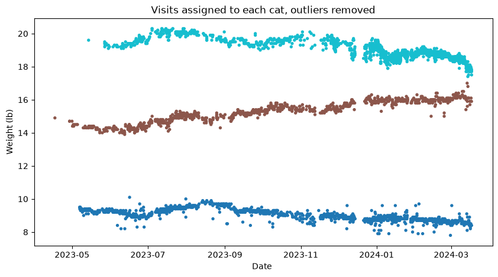
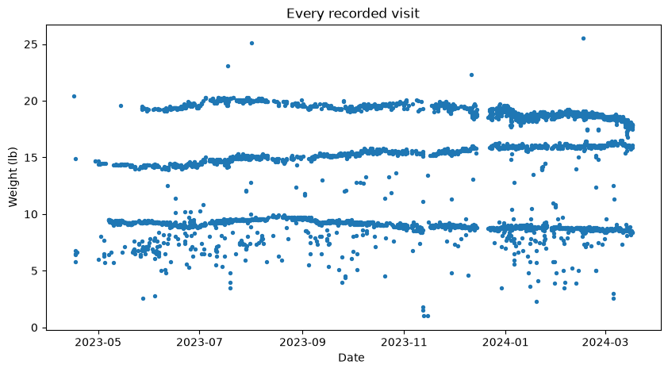
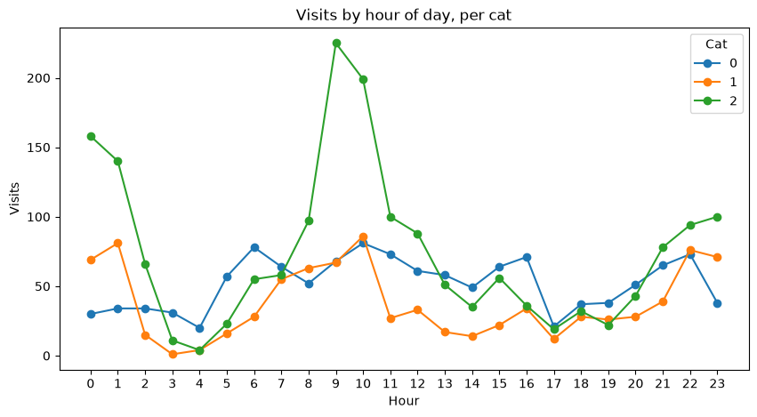

# Litter-Robot cat weights

Three cats share one Litter-Robot 4. Its scale records a weight for every visit but not which cat it
was. This works out which visits belong to which cat from the weights alone, then tracks each cat's
weight over time and when each one uses the box.

## The method (`catweights.py`)

A fixed weight band per cat does not work: the cats' weights drift by a pound or two over months, and
a band wide enough to follow one cat starts catching another's visits. So each cat is a trend line
instead of a band:

1. **Seed the lines.** Sort the visits by weight and split them into one band per cat; fit a line
   (weight against time) to the middle of each band.
2. **Assign.** Each visit goes to the cat whose line predicts the closest weight at that time.
3. **Clean.** Within each cat, drop local outliers: a rolling window over time, removing points
   more than a pound outside the window's 40th to 60th percentile range, repeated until none are left.
   These are mostly a cat stepping half on, or litter shifting during the weigh-in.
4. **Refit and repeat.** Fit each cat's line again on its cleaned visits and run the assignment a
   second time from those better lines.

## Running it

    pip install -r requirements.txt
    python analyze.py            # --cats N for a different number of cats

It reads every `data/YYYY-MM.csv` (one month of the Whisker app's activity export; the year comes
from the file name because the export's timestamps carry none), drops duplicate rows, and writes
`plots/raw.png`, `plots/cats.png` and `plots/by_hour.png`. On the bundled data (April 2023 to
March 2024) it prints:

    4255 weigh-ins, 2023-04-16 to 2024-03-17; 305 dropped as outliers
    cat 0: 1248 visits, 9.4 lb to 8.7 lb (-0.08 lb/month)
    cat 1: 912 visits, 14.1 lb to 16.3 lb (+0.20 lb/month)
    cat 2: 1790 visits, 20.2 lb to 18.5 lb (-0.17 lb/month)

| Every recorded visit | Visits by hour of day |
|---|---|
|  |  |

## Tests

`pip install pytest && pytest` checks the assignment on synthetic cats of known weights.
